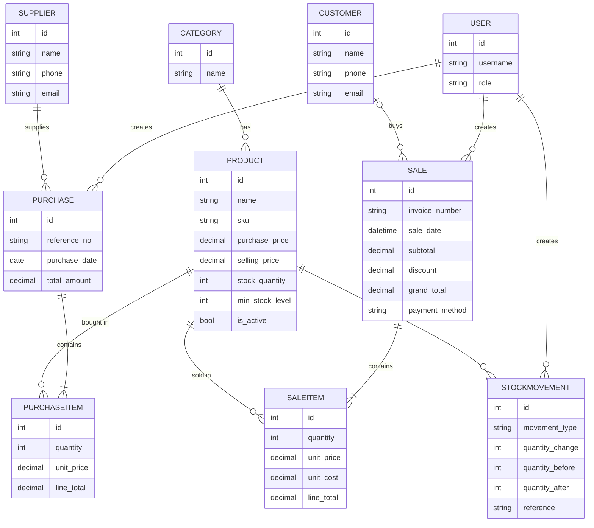

# ARCHITECTURE

## Stack
- **Backend:** Python, Django, Django REST Framework, SQLite, Simple JWT (+ token blacklist), django-cors-headers, drf-spectacular
- **Frontend:** React 18, TypeScript, Vite, Tailwind CSS, React Router, Axios, Recharts, lucide-react, react-hot-toast

## Repository layout
```
inventory-pos-system/
├── backend/
│   ├── config/        settings, root urls, pagination, exception handler, shared helpers
│   ├── accounts/      custom User (role), auth views, user management, permissions
│   ├── categories/    Category
│   ├── products/      Product
│   ├── suppliers/     Supplier
│   ├── customers/     Customer
│   ├── purchases/     Purchase, PurchaseItem, purchase service
│   ├── sales/         Sale, SaleItem, sale service
│   ├── inventory/     StockMovement, stock service (the ONLY place stock changes), adjustment API
│   ├── reports/       report services and APIs
│   └── dashboard/     dashboard API
└── frontend/
    ├── src/api/           Axios client (JWT header, automatic refresh-token retry)
    ├── src/context/       AuthContext (login, logout, current user, role)
    ├── src/hooks/         useFetch, usePagedList, useDebounce
    ├── src/components/    layout (Sidebar, Topbar), ui (Modal, DataTable, Pagination, forms…), ResourcePage (generic CRUD)
    ├── src/pages/         one file per screen (Dashboard, POS, Products, Reports…)
    ├── src/types/         TypeScript types that mirror the API responses
    └── src/utils/         money/date formatting, DRF error parsing, chart helpers
```

## Roles and permissions

| Area | Admin | Cashier |
|---|---|---|
| Auth (register*, login, refresh, logout, me, change password) | ✅ | ✅ |
| Users | full | ❌ |
| Categories, Products, Suppliers | full | read only |
| Customers | full | create / read / update (no delete) |
| Purchases | create / read | ❌ |
| Sales (POS) | create / read all | create / read **own** |
| Current stock, low-stock | read | read |
| Stock movements, stock adjustment | ✅ | ❌ |
| Reports, Dashboard | ✅ | ❌ |
| Product cost price (`purchase_price`) | visible | **hidden** (removed from API responses) |
| Approve / activate / deactivate accounts | ✅ | ❌ |

\* Public self-registration always creates a **Cashier**. A role can never be chosen by the person registering; only an Admin can create Admins (Users page / API) or promote someone.

### Registration & approval flow
1. `GET /api/auth/registration-status/` tells the UI whether the *Create an account* link should be shown.
2. `POST /api/auth/register/` creates a Cashier. By default the account is **inactive** (`SELF_REGISTRATION_AUTO_APPROVE=False`), so it cannot sign in yet.
3. An Admin sees a banner on the dashboard and a **Pending approval** badge on the Users page and clicks **Approve** (`PATCH /api/users/{id}/ {"is_active": true}`).
4. Settings (environment variables): `SELF_REGISTRATION_ENABLED` (default `True`), `SELF_REGISTRATION_AUTO_APPROVE` (default `False`), `REGISTER_THROTTLE_RATE` (default `10/hour` per IP).
5. Security details: usernames are unique case-insensitively, passwords go through Django's password validators, the public endpoint ignores stale `Authorization` headers, and permissions are always checked against the database on every request — so deactivating or demoting a user takes effect immediately, even if they still hold a valid access token.

## Key business rules
1. **Stock changes only through `inventory.services.apply_stock_change`.** It uses a conditional atomic `UPDATE ... WHERE stock >= qty`, so stock can never go negative, and it always writes a `StockMovement`.
2. **Purchases and sales run inside `transaction.atomic`.** If any line fails (inactive product, insufficient stock, invalid discount) nothing is saved.
3. **Totals are always calculated on the server.** Clients send only product and quantity (sales) or product, quantity and unit price (purchases). Selling price comes from the product.
4. **Sales and purchases are immutable** (no update / delete API) so invoices and stock history stay trustworthy.
5. **Unique numbers:** `INV-YYYYMMDD-<id>` and `PUR-YYYYMMDD-<id>`, built from the primary key, so they cannot collide.
6. **Weighted-average cost:** each purchase updates the product's `purchase_price` to the weighted average. Each sale item stores a `unit_cost` snapshot. Estimated profit = total sales (after discount) − cost of goods sold.
7. **Database constraints** back up the rules: non-negative prices and stock, positive quantities, `discount <= subtotal`, `quantity_after = quantity_before + quantity_change`.
8. Products and customers/suppliers with history use `PROTECT` foreign keys; deleting them returns **409** with a clear message (deactivate products instead).
9. Time zone is `Asia/Dhaka`, so "today" and monthly reports follow Bangladesh local dates.

## ER diagram


## Frontend architecture
- **Auth flow:** `POST /api/auth/login/` → access + refresh tokens and user info are stored in `localStorage`. An Axios request interceptor adds `Authorization: Bearer <access>`. On a `401` the response interceptor calls `/api/auth/refresh/` once (concurrent requests share the same refresh call), stores the rotated refresh token and retries the request. If refresh fails the user is signed out and sent to `/login`. Logout blacklists the refresh token via `/api/auth/logout/`.
- **Role sync:** when the browser tab becomes visible again the app re-reads `/api/auth/me/`, so a role / status change made by an Admin shows up without a manual reload (a deactivated user is signed out).
- **Route protection:** `ProtectedRoute` redirects anonymous users to `/login` (and returns them to the page they asked for after login). `RoleRoute` blocks Admin-only pages for Cashiers. The sidebar only lists pages the current role may open. The backend remains the real authority — every endpoint enforces its own permissions.
- **Server is the source of truth:** the POS screen shows an estimated total for convenience, but sends only product IDs and quantities; prices, totals, invoice numbers and stock changes are all calculated by the backend. Backend validation errors (insufficient stock, invalid discount, duplicate SKU…) are parsed by `utils/errors.ts` and shown next to the relevant field or as a message.
- **Reusable building blocks:** `ResourcePage` powers Categories, Suppliers, Customers and Users from a small config (columns + form fields), so every list gets search, pagination, create/edit modal, delete confirmation and error handling for free.
- **Money & dates:** API money values are strings; they are formatted as `৳ 1,234.00`. Dates and "today" use the `Asia/Dhaka` time zone to match the backend.
- **Known trade-off:** tokens live in `localStorage` (simple and fine for a college/final project). For a hardened production deployment consider httpOnly cookies and a stricter CORS / CSP setup.

## Error responses
- `400` validation errors: `{"field": ["message"]}` or `{"items": ["Insufficient stock for 'X': available 1, requested 2."]}`
- `401` not logged in / invalid token · `403` wrong role · `404` not found
- `405` method not allowed (e.g. editing a sale) · `409` record cannot be deleted because other records depend on it
