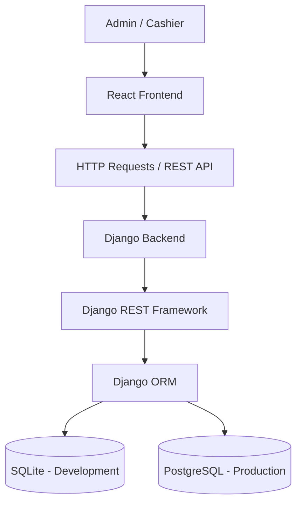
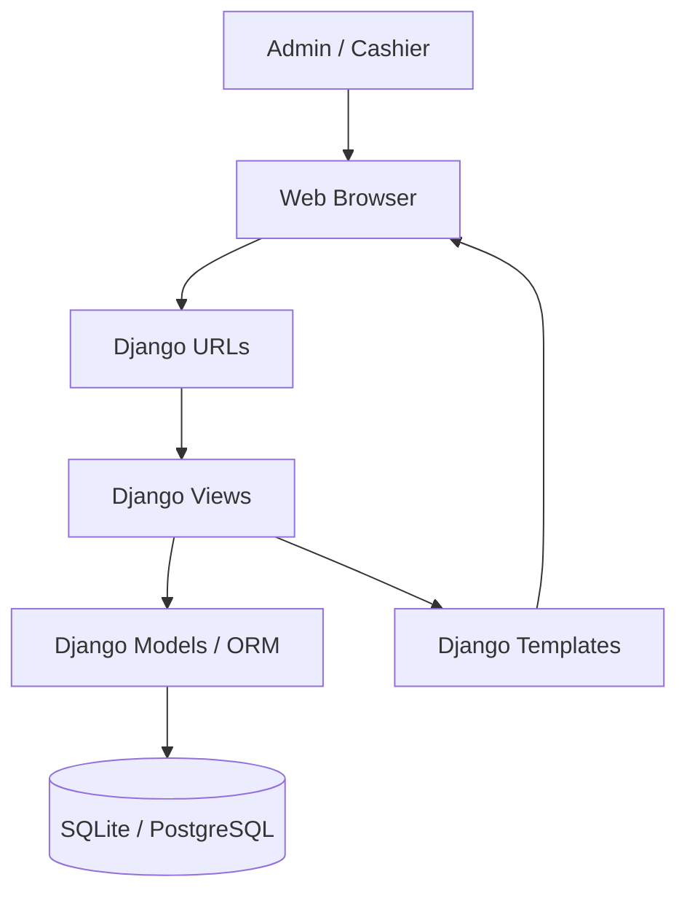
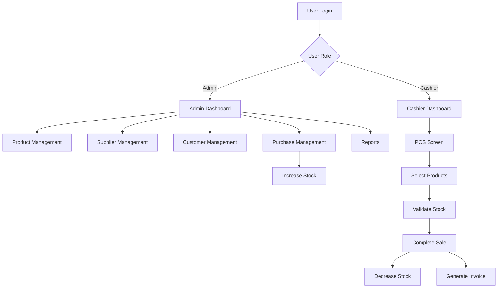
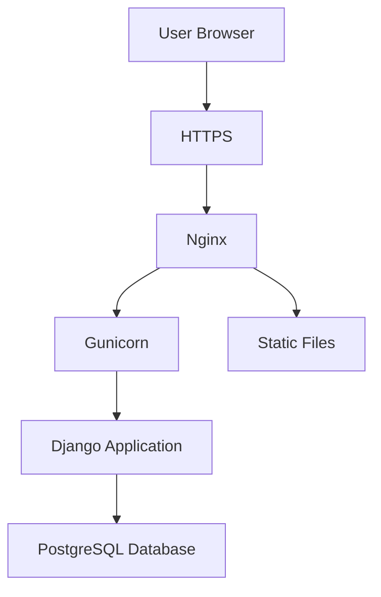

# 📦 Inventory & POS Management System

A web-based **Inventory & Point of Sale (POS) Management System** designed to simplify and automate daily shop operations.

The application provides centralized management of products, categories, suppliers, customers, purchases, sales, stock levels, invoices, and financial reports.

Built with **Python and Django**, the system initially uses SQLite for development, with PostgreSQL planned for production deployment.

---

## 📌 Table of Contents

1. [Project Overview](#-project-overview)
2. [Project Objectives](#-project-objectives)
3. [Key Features](#-key-features)
4. [User Roles and Permissions](#-user-roles-and-permissions)
5. [System Modules](#-system-modules)
6. [Business Logic](#-business-logic)
7. [Technology Stack](#-technology-stack)
8. [System Architecture](#-system-architecture)
9. [Database Design](#-database-design)
10. [Project Structure](#-project-structure)
11. [Installation and Setup](#-installation-and-setup)
12. [Environment Configuration](#-environment-configuration)
13. [Application Workflow](#-application-workflow)
14. [Security](#-security)
15. [Testing](#-testing)
16. [Deployment](#-deployment)
17. [Git and GitHub Workflow](#-git-and-github-workflow)
18. [Future Improvements](#-future-improvements)
19. [Contributing](#-contributing)
20. [Development Team](#-development-team)
21. [License](#-license)

---

## 🚀 Project Overview

The Inventory & POS Management System is designed to help small and medium-sized businesses manage their daily shop activities efficiently.

The system automates inventory updates, purchase entries, sales transactions, invoice generation, and business reporting.

Instead of maintaining stock and sales records manually, administrators and cashiers can perform their respective activities through a centralized web application.

### Project Information

| Information | Details |
|---|---|
| Project Name | Inventory & POS Management System |
| Project Type | Web-Based Application |
| Backend Framework | Django |
| Programming Language | Python |
| Frontend | React / Django Template Language (DTL) |
| Development Database | SQLite |
| Production Database | PostgreSQL |
| Version Control | Git & GitHub |
| Deployment | VPS / Cloud Hosting |
| User Roles | Admin and Cashier |

---

## 🎯 Project Objectives

- Simplify inventory and stock management.
- Automate purchase and sales operations.
- Maintain organized supplier and customer records.
- Reduce manual data entry and calculation errors.
- Generate printable customer invoices.
- Provide daily, monthly, and yearly sales reports.
- Monitor business performance and profitability.
- Implement secure role-based access control.
- Build a scalable application suitable for future business expansion.

---

## ✨ Key Features

### 1. Dashboard

Provides an overview of business activities.

- Total products.
- Total categories.
- Total suppliers.
- Total customers.
- Today's sales summary.
- Monthly sales overview.
- Total purchase amount.
- Low-stock product notifications.
- Sales and purchase statistics.
- Profit and loss overview.

### 2. Product Management

- Add, view, update, and delete products.
- Assign products to categories.
- Store product names and descriptions.
- Set purchase and selling prices.
- Maintain available stock quantities.
- Configure minimum stock levels.
- Search and filter products.
- View product information and stock history.

### 3. Category Management

- Create product categories.
- Update category information.
- View categorized products.
- Organize inventory efficiently.
- Prevent deletion of categories associated with existing products.

### 4. Supplier Management

- Add and update supplier information.
- Store supplier names and contact details.
- Maintain supplier addresses.
- View supplier purchase history.
- Track supplier-wise transactions.

### 5. Customer Management

- Register new customers.
- Store customer names, phone numbers, and addresses.
- Search customers by name or phone number.
- View customer purchase history.
- Maintain customer transaction records.

### 6. Purchase Management

- Create purchase entries.
- Select suppliers.
- Add multiple products to a purchase.
- Record purchase quantities and unit prices.
- Calculate purchase totals automatically.
- Increase product stock after successful purchase completion.
- Maintain purchase history.
- Track supplier-wise purchases.

### 7. POS Sales Management

- Interactive Point of Sale interface.
- Search products quickly.
- Add products to the shopping cart.
- Update product quantities.
- Calculate subtotals and grand totals.
- Select existing customers or register new customers.
- Validate available stock.
- Process sales transactions.
- Automatically decrease stock after successful sales.
- Generate sales records.

### 8. Low Stock Alerts

- Set minimum stock thresholds.
- Identify products running low.
- Display low-stock notifications.
- Highlight products requiring restocking.
- Prevent sales exceeding available stock.

### 9. Invoice Generation

- Generate unique invoice numbers.
- Display shop information.
- Include customer details.
- Display purchased products and quantities.
- Calculate totals and discounts.
- Display payment information.
- Generate printable invoices.
- Maintain invoice history.

### 10. Sales and Financial Reports

Generate reports based on different time periods.

- Daily sales reports.
- Monthly sales reports.
- Yearly sales reports.
- Purchase reports.
- Product-wise sales reports.
- Supplier-wise purchase reports.
- Sales transaction history.
- Profit and loss summary.

### 11. User Management

- Create and manage user accounts.
- Assign Admin and Cashier roles.
- Control access to application modules.
- Protect administrative operations.
- Manage user authentication and authorization.

---

## 👥 User Roles and Permissions

The application supports two primary user roles.

| Feature | Admin | Cashier |
|---|:---:|:---:|
| Dashboard | ✅ | ✅ |
| Product Management | ✅ | ❌ |
| Category Management | ✅ | ❌ |
| Supplier Management | ✅ | ❌ |
| Customer Management | ✅ | ✅ |
| Purchase Management | ✅ | ❌ |
| POS Sales | ✅ | ✅ |
| Invoice Generation | ✅ | ✅ |
| Sales Reports | ✅ | ❌ |
| Purchase Reports | ✅ | ❌ |
| Profit and Loss Reports | ✅ | ❌ |
| User Management | ✅ | ❌ |

**Admin:** Has full access to manage products, inventory, purchases, users, customers, suppliers, sales, and reports.

**Cashier:** Has access to POS operations, customer management, and invoice generation.

All permissions must be enforced through backend authorization, not just frontend visibility.

---

## 🧩 System Modules

| Module | Responsibilities |
|---|---|
| Authentication | Login, logout, user authentication |
| Dashboard | Business statistics and summaries |
| Products | Product and stock management |
| Categories | Product classification |
| Suppliers | Supplier information |
| Customers | Customer information |
| Purchases | Supplier purchase transactions |
| Sales / POS | Customer sales processing |
| Invoices | Invoice generation and printing |
| Reports | Sales and financial reporting |
| User Management | User accounts and permissions |

---

## ⚙️ Business Logic

The system follows automated inventory and transaction management rules.

### Purchase Management Logic

1. Admin selects a supplier.
2. Admin adds products to the purchase.
3. Purchase quantities and unit prices are recorded.
4. System calculates the total purchase amount.
5. Admin confirms the purchase.
6. System saves the purchase transaction.
7. Product stock increases automatically.

**Formula:**

```text
Updated Stock = Previous Stock + Purchased Quantity
```

### Sales Management Logic

1. Cashier opens the POS screen.
2. Cashier selects products.
3. Products are added to the shopping cart.
4. System checks available stock.
5. System calculates the total amount.
6. Cashier confirms the sale.
7. System records the transaction.
8. Product stock decreases automatically.
9. Invoice is generated.

**Formula:**

```text
Updated Stock = Previous Stock - Sold Quantity
```

### Profit Calculation

**Gross Profit:**

```text
Gross Profit = Sales Revenue - Cost of Goods Sold
```

**Net Profit:**

```text
Net Profit = Gross Profit - Operating Expenses
```

Profit calculations should account for discounts, returns, and the selected inventory costing method.

### Important Transaction Rules

- Stock must not become negative.
- Incomplete or failed sales must not reduce stock.
- Purchase and sale operations must use database transactions.
- Each stock change should have a corresponding stock movement record.
- Invoice numbers must be unique.
- Duplicate transaction submissions should be prevented.
- Stock must be restored or adjusted appropriately when a completed purchase or sale is reversed.

---

## 🛠️ Technology Stack

The project uses Python-based backend technologies and a relational database.

| Technology | Purpose |
|---|---|
| Python | Main programming language |
| Django | Backend web framework |
| React.js | Interactive frontend (if selected) |
| Django Template Language (DTL) | Server-rendered frontend (if selected) |
| Django REST Framework | API development (if using React) |
| SQLite | Initial development database |
| PostgreSQL | Planned production database |
| Django ORM | Database operations |
| HTML5 | Web page structure |
| CSS3 | Styling |
| JavaScript | Frontend interactions |
| Git | Version control |
| GitHub | Repository hosting |
| Gunicorn | Production application server |
| Nginx | Reverse proxy and web server |

### Database Strategy

**Development: SQLite**

SQLite will be used during the initial development phase because it is lightweight, easy to configure, and does not require a separate database server.

**Production: PostgreSQL**

PostgreSQL will be introduced during production deployment to support a more robust database environment and concurrent business transactions.

The application should use Django ORM and environment-based database configuration to make the transition easier.

### Frontend Architecture Options

**Option A: React + Django REST Framework**

- React handles the user interface.
- Django handles backend business logic.
- Django REST Framework provides APIs.
- Frontend and backend communicate through HTTP requests.

**Option B: Django + DTL**

- Django handles backend and frontend rendering.
- DTL generates dynamic HTML pages.
- Django forms and views handle user interactions.
- Simpler deployment with fewer separate frontend services.

**Option C: React + DTL Hybrid**

- React handles selected interactive components.
- DTL handles server-rendered pages.
- Requires clearly defined frontend integration.

The final implementation should use one clearly documented architecture.

---

## 🏗️ System Architecture

### React-Based Architecture



### DTL-Based Architecture



---

## 🗄️ Database Design

The following entities are recommended for the application.

| Entity | Purpose |
|---|---|
| User | Stores system user accounts |
| Category | Stores product categories |
| Product | Stores product information and stock |
| Supplier | Stores supplier information |
| Customer | Stores customer information |
| Purchase | Stores purchase transactions |
| PurchaseItem | Stores purchased product details |
| Sale | Stores sales transactions |
| SaleItem | Stores sold product details |
| Invoice | Stores invoice information |
| StockMovement | Tracks inventory changes |

### Database Relationships

- One category can contain multiple products.
- One supplier can have multiple purchases.
- One purchase can contain multiple purchase items.
- One customer can have multiple sales.
- One sale can contain multiple sale items.
- One user can process multiple sales.
- One product can have multiple stock movement records.
- One sale should have a corresponding invoice.

### Database Design Considerations

- Use primary and foreign keys.
- Apply appropriate database constraints.
- Use decimal fields for monetary values.
- Use positive integer fields for stock quantities.
- Store timestamps for important transactions.
- Use database indexes for frequently searched fields.
- Preserve historical purchase and sales prices.
- Avoid hard deletion of completed financial transactions.

---

## 📁 Project Structure

Suggested Django project structure:

```text
inventory-pos-system/
│
├── backend/
│   │
│   ├── config/
│   │   ├── settings.py
│   │   ├── urls.py
│   │   ├── asgi.py
│   │   └── wsgi.py
│   │
│   ├── apps/
│   │   ├── accounts/
│   │   ├── dashboard/
│   │   ├── products/
│   │   ├── categories/
│   │   ├── suppliers/
│   │   ├── customers/
│   │   ├── purchases/
│   │   ├── sales/
│   │   ├── invoices/
│   │   └── reports/
│   │
│   ├── manage.py
│   └── requirements.txt
│
├── frontend/
│   ├── public/
│   ├── src/
│   │   ├── components/
│   │   ├── pages/
│   │   ├── services/
│   │   ├── assets/
│   │   └── App.jsx
│   └── package.json
│
├── docs/
│   ├── database-design.md
│   ├── api-documentation.md
│   └── screenshots/
│
├── tests/
│
├── .env.example
├── .gitignore
└── README.md
```

**Note:** The `frontend/` directory applies to a React implementation. For a DTL implementation, Django templates and static files can be maintained within the relevant Django apps or a central templates/static directory.

---

## 💻 Installation and Setup

Follow these instructions to run the project locally.

### Prerequisites

Install the following software:

- Python 3.12+ (or the version specified by the project).
- Git.
- VS Code or another code editor.
- Node.js and npm (only if using React).
- A modern web browser.

### Step 1: Clone the Repository

```bash
git clone https://github.com/USERNAME/REPOSITORY-NAME.git
```

### Step 2: Navigate to the Project

```bash
cd REPOSITORY-NAME
```

### Step 3: Create a Virtual Environment

Windows:

```bash
python -m venv venv
```

Activate:

```bash
venv\Scripts\activate
```

Linux / macOS:

```bash
python3 -m venv venv
source venv/bin/activate
```

### Step 4: Install Backend Dependencies

```bash
pip install -r backend/requirements.txt
```

If your requirements file is located in the project root, use its actual path instead.

### Step 5: Configure Environment Variables

Create a `.env` file based on `.env.example`.

See the environment configuration section below.

### Step 6: Apply Database Migrations

Navigate to the Django backend directory:

```bash
cd backend
```

Run:

```bash
python manage.py makemigrations
python manage.py migrate
```

### Step 7: Create Admin Account

```bash
python manage.py createsuperuser
```

### Step 8: Start the Django Server

```bash
python manage.py runserver
```

Access the application:

```text
http://127.0.0.1:8000/
```

### Step 9: Run React Frontend (If Applicable)

Open another terminal:

```bash
cd frontend
npm install
npm run dev
```

Use the local URL displayed by the frontend development server.

---

## 🔐 Environment Configuration

Never commit your actual `.env` file to GitHub.

Example `.env.example`:

```env
# Application
DEBUG=True
SECRET_KEY=replace-with-a-secure-secret-key
ALLOWED_HOSTS=localhost,127.0.0.1

# Database
DB_ENGINE=sqlite
DB_NAME=db.sqlite3

# PostgreSQL configuration for future production use
DB_USER=inventory_user
DB_PASSWORD=change-this-password
DB_HOST=localhost
DB_PORT=5432

# Frontend
FRONTEND_URL=http://localhost:5173
```

The actual environment variable names should match your Django settings configuration.

For production, use secure environment variables, a strong secret key, `DEBUG=False`, and the appropriate allowed hosts.

---

## 🔄 Application Workflow



---

## 🔒 Security

Security is essential for protecting business and transaction information.

Recommended security practices:

- Django authentication and password hashing.
- Role-based access control.
- Server-side input validation.
- CSRF protection.
- SQL injection protection through Django ORM.
- Secure session management.
- Environment-based secret management.
- HTTPS for production.
- Restricted access to administrative functions.
- Database transaction handling.
- Regular database backups.
- Audit trails for important stock and financial operations.

---

## 🧪 Testing

The application should be tested before integration and production deployment.

### Recommended Test Cases

| Test Case | Expected Result |
|---|---|
| User login | Authorized users can log in |
| Invalid login | Access is denied |
| Add product | Product is saved successfully |
| Update product | Product information is updated |
| Add purchase | Stock increases correctly |
| Complete sale | Stock decreases correctly |
| Insufficient stock | Sale is rejected |
| Low stock threshold | Alert is displayed |
| Generate invoice | Correct invoice is generated |
| Cashier permissions | Restricted pages are inaccessible |
| Sales report | Correct sales totals are displayed |
| Cancel purchase | Stock is adjusted correctly |
| Failed transaction | No partial stock update occurs |

### Running Django Tests

```bash
python manage.py test
```

For a React frontend, configure and run the frontend test suite separately.

---

## 🚀 Deployment

The application will initially run locally using Django and SQLite.

For production, the recommended architecture is a Linux-based VPS or cloud server using PostgreSQL.

### Recommended Production Stack

| Component | Technology |
|---|---|
| Operating System | Ubuntu Linux |
| Backend | Django |
| Application Server | Gunicorn |
| Web Server | Nginx |
| Database | PostgreSQL |
| Frontend | React build / Django Templates |
| Static Files | Nginx or WhiteNoise |
| Security | HTTPS / SSL |
| Hosting | VPS / Cloud Hosting |

### Production Deployment Architecture



### Production Deployment Steps

1. Provision a Linux VPS or cloud server.
2. Install Python and required system packages.
3. Clone the project repository.
4. Create and activate a Python virtual environment.
5. Install project dependencies.
6. Configure production environment variables.
7. Configure PostgreSQL.
8. Run Django database migrations.
9. Create the initial administrator account.
10. Collect static files.
11. Configure Gunicorn.
12. Configure Nginx as a reverse proxy.
13. Configure a domain name and HTTPS certificate.
14. Configure database backups and application logging.
15. Run security and functionality checks.

### Django Production Checks

```bash
python manage.py check --deploy
```

### Database Migration

```bash
python manage.py migrate
```

### Collect Static Files

```bash
python manage.py collectstatic
```

### Start Gunicorn

```bash
gunicorn config.wsgi:application
```

Replace `config` with the actual Django project package name.

**Important:** Gunicorn is intended for production application serving. Do not use Django's development server as the public production server.

---

## 🌿 Git and GitHub Workflow

This project follows a feature-based Git branching strategy to support collaborative development.

### Branch Structure

```text
main
 │
 └── develop
      │
      ├── feature/dashboard-auth
      ├── feature/product-management
      ├── feature/purchase-management
      ├── feature/pos-sales
      └── feature/reports-invoices
```

### Branch Responsibilities

| Branch | Purpose |
|---|---|
| main | Stable, production-ready code |
| develop | Integration branch |
| feature/* | New feature development |
| bugfix/* | Bug fixes |
| hotfix/* | Urgent production fixes |

### Development Workflow

**Step 1:** Clone the repository.

```bash
git clone <repository-url>
```

**Step 2:** Switch to the development branch.

```bash
git checkout develop
git pull origin develop
```

**Step 3:** Create a feature branch.

```bash
git checkout -b feature/product-management
```

**Step 4:** Make changes and commit.

```bash
git add .
git commit -m "feat: implement product management"
```

**Step 5:** Push the feature branch.

```bash
git push -u origin feature/product-management
```

**Step 6:** Create a Pull Request.

- Source: `feature/product-management`
- Target: `develop`

**Step 7:** Review and test the code before merging.

**Step 8:** Merge tested and approved changes into `main` when the release is ready.

### Commit Message Convention

Use meaningful commit messages.

| Prefix | Purpose |
|---|---|
| feat | New feature |
| fix | Bug fix |
| docs | Documentation |
| style | Code formatting |
| refactor | Code restructuring |
| test | Adding or updating tests |
| chore | Maintenance tasks |

Examples:

```bash
git commit -m "feat: add purchase management"
git commit -m "fix: correct stock calculation"
git commit -m "docs: update installation guide"
git commit -m "test: add POS sales tests"
```

---

## 🔮 Future Improvements

Potential enhancements for future versions:

- Barcode scanning.
- Multiple shop and branch management.
- Product returns and refunds.
- Expense management.
- Supplier payment tracking.
- Customer due management.
- PDF invoice downloads.
- Email and SMS notifications.
- Advanced inventory analytics.
- Stock transfer between branches.
- Cloud-based database backups.
- REST API integrations.
- Advanced user activity logs.
- Mobile-responsive POS interface.

---

## 🤝 Contributing

Contributions are welcome!

To contribute:

1. Fork or clone the repository.
2. Create a feature branch.
3. Implement your changes.
4. Test your implementation.
5. Commit your changes with meaningful messages.
6. Push your feature branch.
7. Submit a Pull Request to `develop`.
8. Wait for code review and approval.

Please follow the project's coding standards and branching conventions.

---

## 👨‍💻 Development Team

**Project:** Inventory & POS Management System

**Project Category:** Full-Stack Web Application

**Backend:** Python & Django

**Frontend:** React / Django Template Language

**Database:** SQLite (Development) / PostgreSQL (Production)

**Version Control:** Git & GitHub

**Team Size:** 5 Members

**Repository:** [GitHub Repository URL]

### Team Members

| No. | Name | Responsibility |
|---|---|---|
| 1 | [Member 1] | [Role / Module] |
| 2 | [Member 2] | [Role / Module] |
| 3 | [Member 3] | [Role / Module] |
| 4 | [Member 4] | [Role / Module] |
| 5 | [Member 5] | [Role / Module] |

---

## 📄 License

This project is developed for educational and practical business management purposes.

An appropriate open-source license should be selected and added before public distribution.

---

## ⭐ Support

If you find this project useful, consider giving the repository a star on GitHub.

**Inventory & POS Management System**

*Simplifying Inventory. Automating Sales. Empowering Business Management.*
