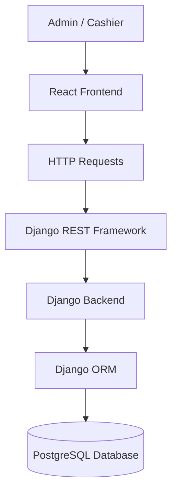
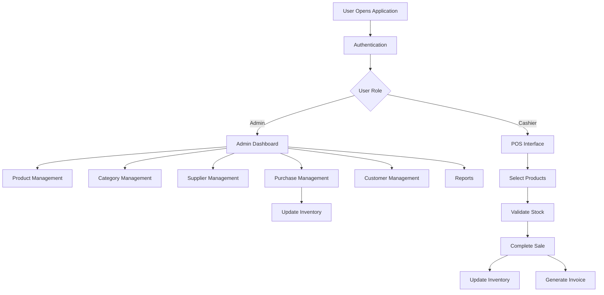
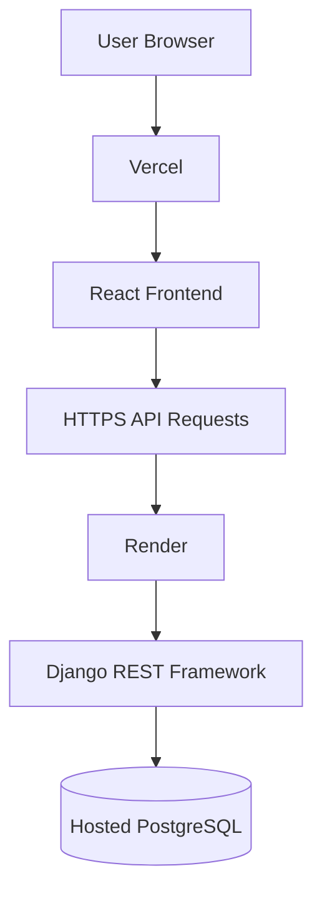

# 📦 Inventory & POS Management System

A full-stack **Inventory & Point of Sale (POS) Management System** developed as a BASIS final project.

The application helps small and medium-sized businesses manage their daily operations through a centralized web-based platform. It provides inventory management, purchase processing, POS sales, customer and supplier management, financial tracking, and business reporting.

The project uses a **Django REST Framework backend** and a modern **React frontend**, with PostgreSQL as its database.

---

## 📌 Table of Contents

1. [Project Overview](#-project-overview)
2. [Project Objectives](#-project-objectives)
3. [Key Features](#-key-features)
4. [User Roles and Permissions](#-user-roles-and-permissions)
5. [System Modules](#-system-modules)
6. [Business Logic](#-business-logic)
7. [Technology Stack](#-technology-stack)
8. [System Architecture](#-system-architecture)
9. [Database Design](#-database-design)
10. [Project Structure](#-project-structure)
11. [Installation and Setup](#-installation-and-setup)
12. [Environment Configuration](#-environment-configuration)
13. [Application Workflow](#-application-workflow)
14. [Security](#-security)
15. [Testing](#-testing)
16. [Deployment](#-deployment)
17. [Git and GitHub Workflow](#-git-and-github-workflow)
18. [Future Improvements](#-future-improvements)
19. [Contributing](#-contributing)
20. [Development Team](#-development-team)
21. [License](#-license)

---

## 🚀 Project Overview

The Inventory & POS Management System is designed to simplify and automate everyday shop management activities.

Instead of maintaining inventory and sales records manually, administrators and cashiers can use a centralized application to manage products, purchases, sales, customers, suppliers, and business performance.

### Project Information

| Information | Details |
|---|---|
| Project Name | Inventory & POS Management System |
| Project Type | Full-Stack Web Application |
| Project Category | BASIS Final Project |
| Backend | Django REST Framework |
| Programming Language | Python |
| Frontend | React + TypeScript |
| Frontend Build Tool | Vite |
| UI Styling | Tailwind CSS |
| Database | PostgreSQL |
| Authentication | JWT |
| API Documentation | drf-spectacular |
| Version Control | Git & GitHub |
| Deployment Plan | Render + Vercel |

---

## 🎯 Project Objectives

- Simplify inventory and stock management.
- Automate purchase and sales operations.
- Maintain organized supplier and customer records.
- Reduce manual data entry and calculation errors.
- Generate printable customer invoices.
- Provide useful sales and purchase reports.
- Monitor business performance and profitability.
- Implement secure role-based access control.
- Develop a modern and user-friendly interface.
- Build a scalable application suitable for future business expansion.

---

## ✨ Key Features

### 1. Dashboard

Provides an overview of important business activities.

- Total products and categories.
- Total suppliers and customers.
- Today's sales summary.
- Monthly sales overview.
- Purchase statistics.
- Low-stock product notifications.
- Sales and purchase statistics.
- Profit and loss overview.

### 2. Product Management

- Add, view, update, and delete products.
- Assign products to categories.
- Store product names and descriptions.
- Set purchase and selling prices.
- Maintain available stock quantities.
- Configure minimum stock levels.
- Search and filter products.
- View product information.

### 3. Category Management

- Create product categories.
- Update category information.
- View categorized products.
- Organize inventory efficiently.
- Prevent deletion of categories associated with existing products.

### 4. Supplier Management

- Add and update supplier information.
- Store supplier names and contact details.
- Maintain supplier addresses.
- View supplier purchase history.
- Track supplier-wise transactions.

### 5. Customer Management

- Register new customers.
- Store customer names, phone numbers, and addresses.
- Search customers by name or phone number.
- View customer purchase history.
- Maintain customer transaction records.

### 6. Purchase Management

- Create purchase entries.
- Select suppliers.
- Add multiple products to a purchase.
- Record purchase quantities and unit prices.
- Calculate purchase totals automatically.
- Increase product stock after successful purchase completion.
- Maintain purchase history.
- Track supplier-wise purchases.

### 7. POS Sales Management

- Interactive Point of Sale interface.
- Search products quickly.
- Add products to the shopping cart.
- Update product quantities.
- Calculate subtotals and grand totals.
- Select existing customers or register new customers.
- Validate available stock.
- Process sales transactions.
- Automatically decrease stock after successful sales.
- Generate sales records.

### 8. Low Stock Alerts

- Set minimum stock thresholds.
- Identify products running low.
- Display low-stock notifications.
- Highlight products requiring restocking.
- Prevent sales exceeding available stock.

### 9. Invoice Generation

- Generate unique invoice numbers.
- Display shop information.
- Include customer details.
- Display purchased products and quantities.
- Calculate totals and discounts.
- Display payment information.
- Generate printable invoices.
- Maintain invoice history.

### 10. Sales and Financial Reports

Generate reports based on different time periods.

- Daily sales reports.
- Monthly sales reports.
- Yearly sales reports.
- Purchase reports.
- Product-wise sales reports.
- Supplier-wise purchase reports.
- Sales transaction history.
- Profit and loss summary.

### 11. User Management

- Manage user accounts.
- Assign Admin and Cashier roles.
- Control access to application modules.
- Protect administrative operations.
- Manage authentication and authorization.

---

## 👥 User Roles and Permissions

The application supports two primary user roles.

| Feature | Admin | Cashier |
|---|:---:|:---:|
| Dashboard | ✅ | ✅ |
| Product Management | ✅ | ❌ |
| Category Management | ✅ | ❌ |
| Supplier Management | ✅ | ❌ |
| Customer Management | ✅ | ✅ |
| Purchase Management | ✅ | ❌ |
| POS Sales | ✅ | ✅ |
| Invoice Generation | ✅ | ✅ |
| Sales Reports | ✅ | ❌ |
| Purchase Reports | ✅ | ❌ |
| Profit and Loss Reports | ✅ | ❌ |
| User Management | ✅ | ❌ |

**Admin:** Has administrative access to manage inventory, purchases, users, customers, suppliers, sales, and reports.

**Cashier:** Has access to POS operations, customer management, and invoice-related activities.

Permissions are enforced through backend authorization rather than relying only on frontend visibility.

---

## 🧩 System Modules

| Module | Responsibilities |
|---|---|
| Authentication | Registration, login, logout, JWT authentication |
| Dashboard | Business statistics and summaries |
| Products | Product and stock management |
| Categories | Product classification |
| Suppliers | Supplier information |
| Customers | Customer information |
| Purchases | Supplier purchase transactions |
| Sales / POS | Customer sales processing |
| Expenses | Business expense management |
| Reports | Sales and financial reporting |

---

## ⚙️ Business Logic

The system follows automated inventory and transaction management rules.

### Purchase Management Logic

1. Admin selects a supplier.
2. Admin adds products to a purchase.
3. Purchase quantities and unit prices are recorded.
4. System calculates the total purchase amount.
5. Admin confirms the purchase.
6. System saves the purchase transaction.
7. Product stock increases accordingly.

**Formula:**

```text
Updated Stock = Previous Stock + Purchased Quantity
```

### Sales Management Logic

1. Cashier opens the POS screen.
2. Cashier selects products.
3. Products are added to the shopping cart.
4. System checks available stock.
5. System calculates the total amount.
6. Cashier confirms the sale.
7. System records the transaction.
8. Product stock decreases accordingly.
9. Invoice information is generated.

**Formula:**

```text
Updated Stock = Previous Stock - Sold Quantity
```

### Profit Calculation

**Gross Profit:**

```text
Gross Profit = Sales Revenue - Cost of Goods Sold
```

**Net Profit:**

```text
Net Profit = Gross Profit - Operating Expenses
```

Actual profit calculations should account for discounts, returns, and the inventory costing method used.

### Important Transaction Rules

- Stock must not become negative.
- Incomplete or failed sales must not reduce stock.
- Purchase and sale operations should use database transactions.
- Invoice numbers must be unique.
- Duplicate transaction submissions should be prevented.
- Stock should be adjusted appropriately when transactions are reversed.

---

## 🛠️ Technology Stack

The project uses a separated frontend and backend architecture.

| Technology | Purpose |
|---|---|
| Python | Main programming language |
| Django | Backend web framework |
| Django REST Framework | REST API development |
| PostgreSQL | Relational database |
| React | Frontend user interface |
| TypeScript | Frontend programming language |
| Vite | Frontend development and build tool |
| Tailwind CSS | UI styling |
| JWT / Simple JWT | Authentication |
| Django ORM | Database operations |
| django-cors-headers | Cross-origin API access |
| drf-spectacular | API documentation |
| WhiteNoise | Static file serving |
| Gunicorn | Production application server |
| Git | Version control |
| GitHub | Repository hosting |

### Database

The project uses **PostgreSQL** for database management.

Database credentials and connection settings are configured through environment variables, keeping sensitive information outside the source code.

### Frontend Architecture

The React frontend communicates with the Django REST API through HTTP requests.

- React manages the user interface.
- TypeScript provides type safety.
- Vite handles development and production builds.
- Tailwind CSS provides responsive styling.
- The backend handles business logic, authentication, validation, and database operations.

---

## 🏗️ System Architecture

The application follows a client-server architecture.



### Architecture Responsibilities

**Frontend**
- Displays the application interface.
- Handles user interactions.
- Manages client-side state.
- Sends API requests.
- Displays API responses and validation errors.

**Backend**
- Handles authentication and authorization.
- Validates incoming requests.
- Executes business logic.
- Processes inventory and financial transactions.
- Communicates with PostgreSQL.
- Returns structured API responses.

**Database**
- Stores users and business information.
- Maintains inventory records.
- Stores purchase and sales transactions.
- Maintains customer and supplier information.

---

## 🗄️ Database Design

The database uses PostgreSQL and Django ORM.

The main business entities include:

| Entity | Purpose |
|---|---|
| User | Stores system user accounts |
| Category | Stores product categories |
| Product | Stores product information and stock |
| Supplier | Stores supplier information |
| Customer | Stores customer information |
| Purchase | Stores purchase transactions |
| PurchaseItem | Stores purchased product details |
| Sale | Stores sales transactions |
| SaleItem | Stores sold product details |
| Expense | Stores business expenses |

### Database Design Considerations

- Use primary and foreign keys.
- Apply appropriate database constraints.
- Use decimal fields for monetary values.
- Use suitable fields for stock quantities.
- Store timestamps for important transactions.
- Use indexes for frequently searched fields.
- Preserve historical purchase and sales prices.
- Avoid hard deletion of completed financial transactions.

---

## 📁 Project Structure

The repository is organized into separate backend and frontend directories.

```text
inventory_pos_system/
│
├── backend/
│   ├── config/
│   │   ├── settings.py
│   │   ├── urls.py
│   │   ├── asgi.py
│   │   └── wsgi.py
│   │
│   ├── apps/
│   │   ├── accounts/
│   │   ├── dashboard/
│   │   ├── products/
│   │   ├── categories/
│   │   ├── suppliers/
│   │   ├── customers/
│   │   ├── purchases/
│   │   ├── sales/
│   │   └── expenses/
│   │
│   ├── manage.py
│   ├── requirements.txt
│   └── .env
│
├── frontend/
│   ├── public/
│   ├── src/
│   ├── package.json
│   ├── vite.config.ts
│   └── .env
│
├── API_DOCUMENTATION.md
├── ARCHITECTURE.md
├── PROGRESS.md
├── README.md
└── .gitignore
```

**Note:** Environment files, virtual environments, dependency directories, generated build files, and other sensitive or temporary files are excluded from version control.

---

## 💻 Installation and Setup

Follow these instructions to run the project locally.

### Prerequisites

Install the following software:

- Python
- Node.js and npm
- PostgreSQL
- Git
- VS Code or another code editor

### Step 1: Clone the Repository

```bash
git clone <repository-url>
```

### Step 2: Navigate to the Project

```bash
cd inventory_pos_system
```

### Step 3: Set Up the Backend

Navigate to the backend directory:

```bash
cd backend
```

Create a virtual environment:

```bash
python -m venv venv
```

Activate it on Windows:

```bash
venv\Scripts\activate
```

Install the dependencies:

```bash
pip install -r requirements.txt
```

### Step 4: Configure Environment Variables

Create a `.env` file inside the backend directory.

Configure your local PostgreSQL database credentials and application settings.

See the environment configuration section below.

### Step 5: Apply Database Migrations

```bash
python manage.py migrate
```

Create an administrator account if required:

```bash
python manage.py createsuperuser
```

### Step 6: Start the Backend Server

```bash
python manage.py runserver
```

The Django development server will run at:

```text
http://127.0.0.1:8000/
```

### Step 7: Set Up the Frontend

Open another terminal and navigate to the frontend directory:

```bash
cd frontend
```

Install dependencies:

```bash
npm install
```

Configure the frontend environment variable:

```env
VITE_API_URL=http://127.0.0.1:8000/api
```

Start the frontend development server:

```bash
npm run dev
```

Vite will display the local frontend URL in the terminal, usually:

```text
http://localhost:5173/
```

---

## 🔐 Environment Configuration

Environment variables are used to manage application configuration and sensitive credentials.

Never commit actual `.env` files or database passwords to GitHub.

### Backend Environment Variables

Example configuration:

```env
# Application
SECRET_KEY=your-secret-key
DEBUG=True

# Database
DB_NAME=inventory_pos
DB_USER=postgres
DB_PASSWORD=your-local-database-password
DB_HOST=localhost
DB_PORT=5432

# Hosts and frontend access
ALLOWED_HOSTS=localhost,127.0.0.1
CSRF_TRUSTED_ORIGINS=http://localhost:5173
CORS_ALLOWED_ORIGINS=http://localhost:5173,http://127.0.0.1:5173
```

### Frontend Environment Variables

```env
VITE_API_URL=http://127.0.0.1:8000/api
```

For production, configure the appropriate environment variables through the hosting providers. Use a secure secret key, `DEBUG=False`, production database credentials, and the correct domain names.

---

## 🔄 Application Workflow



---

## 🔒 Security

Security is essential for protecting business and transaction information.

The application uses or is configured for the following security measures:

- JWT-based authentication.
- Role-based access control.
- Backend request validation.
- Django password hashing.
- CSRF protection.
- CORS configuration.
- Django ORM for database operations.
- Environment-based secret management.
- HTTPS configuration for production.
- Restricted access to administrative operations.

Production deployment must use secure environment variables and disable Django debug mode.

---

## 🧪 Testing

The backend includes automated tests for important application functionality.

**Current project test suite: 93 tests** (as recorded in the project documentation).

Run the Django test suite from the backend directory:

```bash
python manage.py test
```

### Testing Objectives

- Validate authentication and authorization.
- Verify product and category operations.
- Test purchase and sales calculations.
- Validate stock updates.
- Check customer and supplier operations.
- Verify report calculations.
- Ensure restricted operations are protected.

Frontend tests should be run separately when a frontend test suite is configured.

---

## 🚀 Deployment

The project is being prepared for free cloud deployment using separate hosting services for the frontend and backend.

### Planned Production Stack

| Component | Platform / Technology |
|---|---|
| Frontend | Vercel |
| Backend | Render |
| Database | Hosted PostgreSQL |
| Backend Framework | Django REST Framework |
| Application Server | Gunicorn |
| Static Files | WhiteNoise |
| Database Connection | Environment variables |

### Deployment Architecture



### Backend Deployment Preparation

The backend is configured for production deployment with:

- PostgreSQL database support.
- Environment-based configuration.
- WhiteNoise static file handling.
- Gunicorn application server.
- Production host and CORS settings.
- HTTPS-aware security settings.

### Frontend Deployment Preparation

The frontend uses a production API URL configured through the Vercel environment variables.

Example:

```env
VITE_API_URL=https://your-backend-domain/api
```

### Important Deployment Notes

- Keep production credentials out of GitHub.
- Configure `DEBUG=False` in production.
- Configure the correct `ALLOWED_HOSTS`.
- Configure frontend CORS and CSRF trusted origins.
- Run database migrations after deployment.
- Verify API connectivity between frontend and backend.
- Test authentication, sales, purchases, and reports in the deployed environment.

**Deployment status:** Deployment preparation is in progress. The production URLs should be added here after successful deployment.

---

## 🌿 Git and GitHub Workflow

The project uses Git and GitHub for version control and collaborative development.

### Branch Structure

```text
main
 │
 └── develop
      │
      ├── feature/dashboard-auth
      ├── feature/product-management
      ├── feature/purchase-management
      ├── feature/pos-sales
      └── feature/reports-invoices
```

### Branch Responsibilities

| Branch | Purpose |
|---|---|
| `main` | Stable, production-ready code |
| `develop` | Integration branch |
| `feature/*` | New feature development |
| `bugfix/*` | Bug fixes |
| `hotfix/*` | Urgent production fixes |

### Development Workflow

**Step 1: Clone the repository**

```bash
git clone <repository-url>
```

**Step 2: Switch to the development branch**

```bash
git switch develop
git pull origin develop
```

**Step 3: Create a feature branch**

```bash
git switch -c feature/product-management
```

**Step 4: Make changes and commit**

```bash
git add .
git commit -m "feat: implement product management"
```

**Step 5: Push the feature branch**

```bash
git push -u origin feature/product-management
```

**Step 6: Create a Pull Request**

- Source: `feature/product-management`
- Target: `develop`

**Step 7:** Review and test the code before merging.

**Step 8:** Merge tested and approved changes into `main` when the release is ready.

### Commit Message Convention

| Prefix | Purpose |
|---|---|
| `feat` | New feature |
| `fix` | Bug fix |
| `docs` | Documentation |
| `style` | Code formatting |
| `refactor` | Code restructuring |
| `test` | Adding or updating tests |
| `chore` | Maintenance tasks |

Examples:

```bash
git commit -m "feat: add purchase management"
git commit -m "fix: correct stock calculation"
git commit -m "docs: update installation guide"
git commit -m "test: add POS sales tests"
```

---

## 🔮 Future Improvements

Potential enhancements for future versions:

- Barcode scanning.
- Multiple shop and branch management.
- Product returns and refunds.
- Supplier payment tracking.
- Customer due management.
- PDF invoice downloads.
- Email and SMS notifications.
- Advanced inventory analytics.
- Stock transfers between branches.
- Cloud-based database backups.
- Advanced user activity logs.
- Additional reporting and analytics features.

---

## 🤝 Contributing

Contributions are welcome!

To contribute:

1. Fork or clone the repository.
2. Create a feature branch.
3. Implement your changes.
4. Test your implementation.
5. Commit your changes with meaningful messages.
6. Push your feature branch.
7. Submit a Pull Request to `develop`.
8. Wait for code review and approval.

Please follow the project's coding standards and branching conventions.

---

## 👨‍💻 Development Team

**Project:** Inventory & POS Management System

**Project Category:** Full-Stack Web Application

**Backend:** Python, Django & Django REST Framework

**Frontend:** React, TypeScript, Vite & Tailwind CSS

**Database:** PostgreSQL

**Version Control:** Git & GitHub

**Team Size:** 5 Members

**Repository:** [GitHub Repository URL]

### Team Members

| No. | Name | Responsibility |
|---|---|---|
| 1 | [Member 1] | [Role / Module] |
| 2 | [Member 2] | [Role / Module] |
| 3 | [Member 3] | [Role / Module] |
| 4 | [Member 4] | [Role / Module] |
| 5 | [Member 5] | [Role / Module] |

---

## 📄 License

This project is developed for educational and practical business management purposes.

An appropriate open-source license should be selected and added before public distribution.

---

## ⭐ Support

If you find this project useful, consider giving the repository a star on GitHub.

**Inventory & POS Management System**

*Simplifying Inventory. Automating Sales. Empowering Business Management.*
