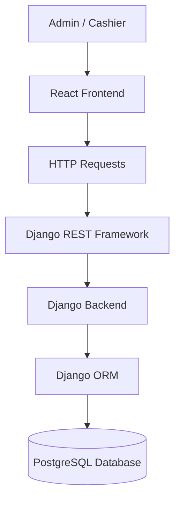
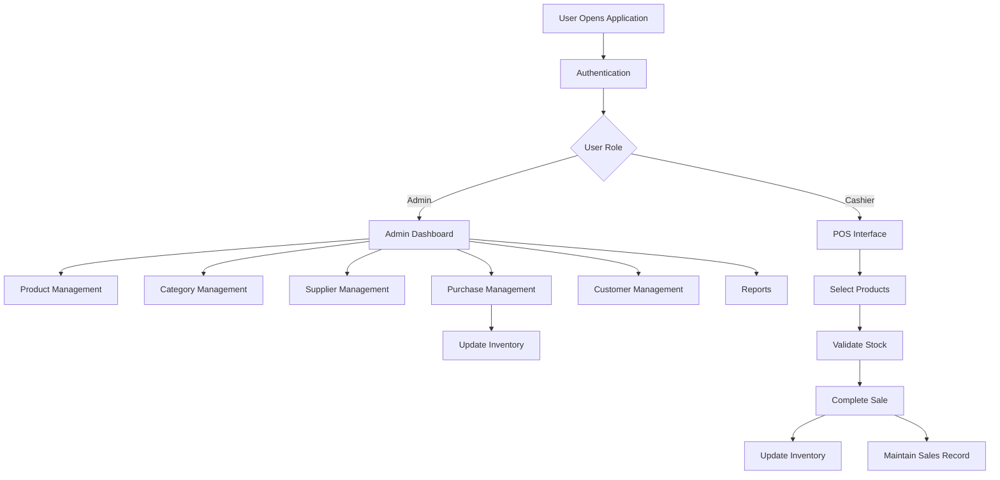
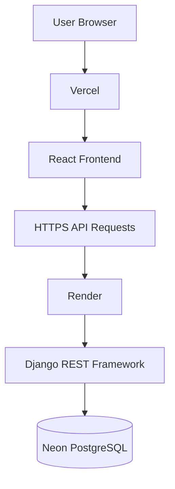

# 📦 Inventory & POS Management System

A full-stack **Inventory & Point of Sale (POS) Management System** developed as a **BASIS final project** by a team of five members.

The application helps small and medium-sized businesses manage their daily operations through a centralized web-based platform. It provides product and inventory management, purchase processing, POS sales, customer and supplier management, sales returns, and business reporting.

The project uses a **Django REST Framework backend**, a modern **React + TypeScript frontend**, and **PostgreSQL** as its database.

🌐 **Live Application:** [https://inventory-pos-system-ten.vercel.app](https://inventory-pos-system-ten.vercel.app)

💻 **GitHub Repository:** [inventory_pos_system](https://github.com/radiamahbub/inventory_pos_system)

---

## 📌 Table of Contents

1. [Project Overview](#-project-overview)
2. [Project Objectives](#-project-objectives)
3. [Key Features](#-key-features)
4. [User Roles and Permissions](#-user-roles-and-permissions)
5. [System Modules](#-system-modules)
6. [Business Logic](#-business-logic)
7. [Technology Stack](#-technology-stack)
8. [System Architecture](#-system-architecture)
9. [Database Design](#-database-design)
10. [Project Structure](#-project-structure)
11. [Installation and Setup](#-installation-and-setup)
12. [Environment Configuration](#-environment-configuration)
13. [Application Workflow](#-application-workflow)
14. [Security](#-security)
15. [Testing](#-testing)
16. [Deployment](#-deployment)
17. [Git and GitHub Workflow](#-git-and-github-workflow)
18. [Future Improvements](#-future-improvements)
19. [Contributing](#-contributing)
20. [Development Team](#-development-team)
21. [License](#-license)

---

## 🚀 Project Overview

The Inventory & POS Management System is designed to simplify and automate everyday shop management activities.

Instead of maintaining inventory and sales records manually, administrators and cashiers can use a centralized application to manage products, purchases, sales, customers, suppliers, and business performance.

### Project Information

| Information | Details |
|---|---|
| Project Name | Inventory & POS Management System |
| Project Type | Full-Stack Web Application |
| Project Category | BASIS Final Project |
| Backend | Django REST Framework |
| Programming Language | Python |
| Frontend | React + TypeScript |
| Frontend Build Tool | Vite |
| UI Styling | Tailwind CSS |
| Database | PostgreSQL |
| Authentication | JWT |
| API Documentation | drf-spectacular |
| Version Control | Git & GitHub |
| Frontend Hosting | Vercel |
| Backend Hosting | Render |
| Database Hosting | Neon PostgreSQL |
| Live Application | https://inventory-pos-system-ten.vercel.app |

---

## 🎯 Project Objectives

- Simplify inventory and stock management.
- Automate purchase and sales operations.
- Maintain organized supplier and customer records.
- Reduce manual data entry and calculation errors.
- Generate printable customer invoices.
- Provide useful sales and purchase reports.
- Monitor business performance.
- Implement secure role-based access control.
- Develop a modern and user-friendly interface.
- Build a scalable application suitable for future business expansion.

---

## ✨ Key Features

### 1. Dashboard

Provides an overview of important business activities.

- Total products and categories.
- Total suppliers and customers.
- Sales summaries.
- Purchase statistics.
- Inventory information.
- Low-stock product monitoring.
- Business performance information.

### 2. Product Management

- Add, view, update, and delete products.
- Assign products to categories.
- Store product names and descriptions.
- Set purchase and selling prices.
- Maintain available stock quantities.
- Configure minimum stock levels.
- Search and filter products.
- View product information.

### 3. Category Management

- Create product categories.
- Update category information.
- View categorized products.
- Organize inventory efficiently.
- Protect categories associated with existing products.

### 4. Supplier Management

- Add and update supplier information.
- Store supplier names and contact details.
- Maintain supplier addresses.
- View supplier purchase history.
- Track supplier-wise transactions.

### 5. Customer Management

- Register new customers.
- Store customer names, phone numbers, and addresses.
- Search customers by name or phone number.
- View customer purchase history.
- Maintain customer transaction records.

### 6. Purchase Management

- Create purchase entries.
- Select suppliers.
- Add multiple products to a purchase.
- Record purchase quantities and unit prices.
- Calculate purchase totals.
- Increase product stock after successful purchase completion.
- Maintain purchase history.
- Track supplier-wise purchases.

### 7. POS Sales Management

- Interactive Point of Sale interface.
- Search products quickly.
- Add products to the shopping cart.
- Update product quantities.
- Calculate subtotals and grand totals.
- Select existing customers.
- Validate available stock.
- Process sales transactions.
- Automatically decrease stock after successful sales.
- Generate sales records.

### 8. Inventory and Stock Management

- Track available product quantities.
- Record stock movements.
- Monitor stock changes from purchases and sales.
- Configure minimum stock thresholds.
- Identify products running low.
- Prevent sales exceeding available stock.

### 9. Invoice and Sales Records

- Maintain sales transaction records.
- Display customer and product information.
- Record purchased quantities and prices.
- Calculate transaction totals.
- Maintain sales history.
- Support invoice-related operations.

### 10. Sales Returns

- Maintain sales return records.
- Record returned products.
- Track return transactions.
- Maintain historical return information.

### 11. Reports

- Sales information and summaries.
- Purchase information.
- Product-related reporting.
- Inventory information.
- Business performance reporting.

### 12. User Management

- Manage user accounts.
- Assign Admin and Cashier roles.
- Control access to application modules.
- Protect administrative operations.
- Manage authentication and authorization.

---

## 👥 User Roles and Permissions

The application supports two primary user roles.

| Feature | Admin | Cashier |
|---|:---:|:---:|
| Dashboard | ✅ | ✅ |
| Product Management | ✅ | ❌ |
| Category Management | ✅ | ❌ |
| Supplier Management | ✅ | ❌ |
| Customer Management | ✅ | ✅ |
| Purchase Management | ✅ | ❌ |
| POS Sales | ✅ | ✅ |
| Sales Records | ✅ | Based on permissions |
| Sales Returns | ✅ | Based on permissions |
| Reports | ✅ | ❌ |
| User Management | ✅ | ❌ |

**Admin:** Has administrative access to manage inventory, purchases, users, customers, suppliers, sales, and reports.

**Cashier:** Has access to permitted POS operations and customer-related activities.

Permissions are enforced through backend authorization rather than relying only on frontend visibility.

---

## 🧩 System Modules

The backend is organized into Django applications.

| Module | Responsibilities |
|---|---|
| Accounts | User accounts, authentication, and roles |
| Dashboard | Business statistics and summaries |
| Products | Product information and stock-related data |
| Categories | Product classification |
| Suppliers | Supplier information |
| Customers | Customer information and payment records |
| Purchases | Purchase transactions and purchase items |
| Sales | Sales transactions, sale items, and returns |
| Inventory | Stock movements and inventory tracking |
| Reports | Business and transaction reporting |

---

## ⚙️ Business Logic

The system follows automated inventory and transaction management rules.

### Purchase Management Logic

1. Admin selects a supplier.
2. Admin adds products to a purchase.
3. Purchase quantities and unit prices are recorded.
4. System calculates the purchase amount.
5. Admin confirms the purchase.
6. System saves the purchase transaction.
7. Product stock increases accordingly.

**Formula:**

```text
Updated Stock = Previous Stock + Purchased Quantity
```

### Sales Management Logic

1. Cashier opens the POS screen.
2. Cashier selects products.
3. Products are added to the shopping cart.
4. System checks available stock.
5. System calculates the total amount.
6. Cashier confirms the sale.
7. System records the transaction.
8. Product stock decreases accordingly.
9. Sales and invoice information is maintained.

**Formula:**

```text
Updated Stock = Previous Stock - Sold Quantity
```

### Important Transaction Rules

- Stock must not become negative.
- Incomplete or failed sales must not reduce stock.
- Purchase and sale operations should maintain data consistency.
- Transaction records should preserve historical information.
- Stock should be adjusted appropriately when transactions are reversed or returned.

---

## 🛠️ Technology Stack

The project uses a separated frontend and backend architecture.

| Technology | Purpose |
|---|---|
| Python | Main programming language |
| Django | Backend web framework |
| Django REST Framework | REST API development |
| PostgreSQL | Relational database |
| React | Frontend user interface |
| TypeScript | Frontend programming language |
| Vite | Frontend development and build tool |
| Tailwind CSS | UI styling |
| Simple JWT | Authentication |
| Django ORM | Database operations |
| django-cors-headers | Cross-origin API access |
| drf-spectacular | API documentation |
| WhiteNoise | Static file serving |
| Gunicorn | Production application server |
| Git | Version control |
| GitHub | Repository hosting |

### Frontend Architecture

The React frontend communicates with the Django REST API through HTTP requests.

- React manages the user interface.
- TypeScript provides type safety.
- Vite handles development and production builds.
- Tailwind CSS provides responsive styling.
- The backend handles business logic, authentication, validation, and database operations.

### Database

The project uses **PostgreSQL** for database management.

Database credentials and connection settings are configured through environment variables, keeping sensitive information outside the source code.

---

## 🏗️ System Architecture

The application follows a client-server architecture.



### Architecture Responsibilities

**Frontend**
- Displays the application interface.
- Handles user interactions.
- Manages client-side state.
- Sends API requests.
- Displays API responses and validation errors.

**Backend**
- Handles authentication and authorization.
- Validates incoming requests.
- Executes business logic.
- Processes inventory and financial transactions.
- Communicates with PostgreSQL.
- Returns structured API responses.

**Database**
- Stores users and business information.
- Maintains inventory records.
- Stores purchase and sales transactions.
- Maintains customer and supplier information.

---

## 🗄️ Database Design

The database uses PostgreSQL and Django ORM.

The main business entities include:

| Entity | Purpose |
|---|---|
| User | Stores system user accounts |
| Category | Stores product categories |
| Product | Stores product information |
| Supplier | Stores supplier information |
| Customer | Stores customer information |
| CustomerPayment | Stores customer payment records |
| Purchase | Stores purchase transactions |
| PurchaseItem | Stores purchased product details |
| Sale | Stores sales transactions |
| SaleItem | Stores sold product details |
| SaleReturn | Stores sales return transactions |
| SaleReturnItem | Stores returned product details |
| StockMovement | Stores inventory movement history |

### Database Design Considerations

- Use primary and foreign keys.
- Apply appropriate database constraints.
- Use decimal fields for monetary values.
- Store timestamps for important transactions.
- Use indexes for frequently searched fields.
- Preserve historical purchase and sales prices.
- Maintain relationships between transactions and their associated users, customers, suppliers, and products.

---

## 📁 Project Structure

The repository contains separate backend and frontend directories.

```text
inventory_pos_system/
│
├── backend/
│   ├── config/
│   │   ├── settings.py
│   │   ├── urls.py
│   │   ├── asgi.py
│   │   └── wsgi.py
│   │
│   ├── accounts/
│   ├── categories/
│   ├── products/
│   ├── suppliers/
│   ├── customers/
│   ├── purchases/
│   ├── sales/
│   ├── inventory/
│   ├── dashboard/
│   ├── reports/
│   │
│   ├── manage.py
│   └── requirements.txt
│
├── frontend/
│   ├── public/
│   ├── src/
│   ├── package.json
│   ├── vite.config.ts
│   └── .env
│
├── .gitignore
└── README.md
```

**Note:** Environment files, virtual environments, database backups, dependency directories, generated build files, and other sensitive or temporary files are excluded from version control.

---

## 💻 Installation and Setup

Follow these instructions to run the project locally.

### Prerequisites

Install the following software:

- Python
- Node.js and npm
- PostgreSQL
- Git
- VS Code or another code editor

### Step 1: Clone the Repository

```bash
git clone https://github.com/radiamahbub/inventory_pos_system.git
```

### Step 2: Navigate to the Project

```bash
cd inventory_pos_system
```

### Step 3: Set Up the Backend

```bash
cd backend
```

Create a virtual environment:

```bash
python -m venv venv
```

Activate it on Windows:

```cmd
venv\Scripts\activate
```

Install the dependencies:

```bash
pip install -r requirements.txt
```

### Step 4: Configure Environment Variables

Create a `.env` file inside the backend directory.

Configure your local PostgreSQL database credentials and application settings.

See the environment configuration section below.

### Step 5: Apply Database Migrations

```bash
python manage.py migrate
```

Create an administrator account if required:

```bash
python manage.py createsuperuser
```

### Step 6: Start the Backend Server

```bash
python manage.py runserver
```

The Django development server will run at:

```text
http://127.0.0.1:8000/
```

### Step 7: Set Up the Frontend

Open another terminal and navigate to the project frontend:

```bash
cd inventory_pos_system/frontend
```

Install dependencies:

```bash
npm install
```

Configure the frontend environment variable:

```env
VITE_API_URL=http://127.0.0.1:8000/api
```

Start the frontend development server:

```bash
npm run dev
```

Vite will display the local frontend URL in the terminal, usually:

```text
http://localhost:5173/
```

---

## 🔐 Environment Configuration

Environment variables are used to manage application configuration and sensitive credentials.

Never commit actual `.env` files or database passwords to GitHub.

### Backend Environment Variables

Example local configuration:

```env
SECRET_KEY=your-secret-key
DEBUG=True

DB_NAME=inventory_pos
DB_USER=postgres
DB_PASSWORD=your-local-database-password
DB_HOST=localhost
DB_PORT=5432
DB_SSLMODE=prefer
```

### Frontend Environment Variables

```env
VITE_API_URL=http://127.0.0.1:8000/api
```

For production, configure the appropriate environment variables through the hosting providers. Use a secure secret key, `DEBUG=False`, production database credentials, and the correct domain names.

---

## 🔄 Application Workflow



---

## 🔒 Security

Security is essential for protecting business and transaction information.

The application uses or is configured for the following security measures:

- JWT-based authentication.
- Role-based access control.
- Backend request validation.
- Django password hashing.
- CSRF protection.
- CORS configuration.
- Django ORM for database operations.
- Environment-based secret management.
- HTTPS for production access.
- Restricted access to administrative operations.

Production deployment uses secure environment variables and disables Django debug mode.

---

## 🧪 Testing

The backend includes Django's testing framework for application functionality.

Run the backend test suite from the backend directory:

```bash
python manage.py test
```

### Testing Objectives

- Validate authentication and authorization.
- Verify product and category operations.
- Test purchase and sales calculations.
- Validate stock updates.
- Check customer and supplier operations.
- Verify report calculations.
- Ensure restricted operations are protected.

Frontend testing can be added or run separately as the frontend test suite is configured.

---

## 🚀 Deployment

The application has been successfully deployed using separate cloud hosting services for the frontend, backend, and database.

### Production Deployment

| Component | Platform | Status |
|---|---|---|
| Frontend | Vercel | Deployed |
| Backend | Render | Deployed |
| Database | Neon PostgreSQL | Connected |
| Custom Domain | Not in use | Removed |
| HTTPS | Vercel deployment URL | Enabled |

### Live URLs

| Service | URL |
|---|---|
| Main Website | [https://inventory-pos-system-ten.vercel.app](https://inventory-pos-system-ten.vercel.app) |
| Root Domain | [https://inventory-pos-system-ten.vercel.app](https://inventory-pos-system-ten.vercel.app) |
| Frontend Deployment | [Vercel](https://inventory-pos-system-ten.vercel.app) |
| Backend Health Check | [Render API Health](https://inventory-pos-backend-4119.onrender.com/api/health/) |
| Source Code | [GitHub Repository](https://github.com/radiamahbub/inventory_pos_system) |

### Deployment Architecture



### Production Configuration

**Frontend — Vercel**
- Hosts the React application.
- Uses the production API URL.
- Serves the application through its Vercel deployment URL.

**Backend — Render**
- Hosts the Django REST Framework API.
- Uses Gunicorn as the production application server.
- Uses WhiteNoise for static files.
- Connects to the production PostgreSQL database.

**Database — Neon**
- Hosts the production PostgreSQL database.
- Stores application users and business records.
- Uses a secure database connection.

### Deployment Notes

- Production credentials are stored in hosting environment variables.
- Database migrations are applied to the production database.
- The original business data was migrated from SQLite to PostgreSQL.
- Database backups are maintained separately from the GitHub repository.

**The application is live and accessible through its Vercel deployment URL.**

---

## 🌿 Git and GitHub Workflow

The project uses Git and GitHub for version control and collaborative development.

### Branch Structure

```text
main
 │
 └── develop
      │
      ├── feature/dashboard-auth
      ├── feature/product-management
      ├── feature/purchase-management
      ├── feature/pos-sales
      └── feature/reports-invoices
```

### Branch Responsibilities

| Branch | Purpose |
|---|---|
| `main` | Stable, production-ready code |
| `develop` | Integration and development branch |
| `feature/*` | New feature development |
| `bugfix/*` | Bug fixes |
| `hotfix/*` | Urgent production fixes |

### Development Workflow

**Step 1: Clone the repository**

```bash
git clone https://github.com/radiamahbub/inventory_pos_system.git
```

**Step 2: Switch to the development branch**

```bash
git switch develop
git pull origin develop
```

**Step 3: Create a feature branch**

```bash
git switch -c feature/product-management
```

**Step 4: Make changes and commit**

```bash
git add .
git commit -m "feat: implement product management"
```

**Step 5: Push the feature branch**

```bash
git push -u origin feature/product-management
```

**Step 6:** Create a Pull Request targeting `develop`.

**Step 7:** Review and test the code before merging.

**Step 8:** Merge tested and approved changes into `main` when the release is ready.

### Commit Message Convention

| Prefix | Purpose |
|---|---|
| `feat` | New feature |
| `fix` | Bug fix |
| `docs` | Documentation |
| `style` | Code formatting |
| `refactor` | Code restructuring |
| `test` | Adding or updating tests |
| `chore` | Maintenance tasks |

Examples:

```bash
git commit -m "feat: add purchase management"
git commit -m "fix: correct stock calculation"
git commit -m "docs: update installation guide"
git commit -m "test: add POS sales tests"
```

---

## 🔮 Future Improvements

Potential enhancements for future versions:

- Barcode scanning.
- Multiple shop and branch management.
- Advanced product returns and refunds.
- Supplier payment tracking.
- Customer due management.
- PDF invoice downloads.
- Email and SMS notifications.
- Advanced inventory analytics.
- Stock transfers between branches.
- Automated cloud database backups.
- Advanced user activity logs.
- Additional reporting and analytics features.

---

## 🤝 Contributing

Contributions are welcome!

To contribute:

1. Fork or clone the repository.
2. Create a feature branch.
3. Implement your changes.
4. Test your implementation.
5. Commit your changes with meaningful messages.
6. Push your feature branch.
7. Submit a Pull Request to `develop`.
8. Wait for code review and approval.

Please follow the project's coding standards and branching conventions.

---

## 👨‍💻 Development Team

**Project:** Inventory & POS Management System

**Project Category:** BASIS Final Project

**Project Type:** Full-Stack Web Application

**Team Size:** 5 Members

### Team Members

| No. | Name |
|---|---|
| 1 | Md. Abdul Rafeu |
| 2 | Radia Mahbub |
| 3 | Aysha Jarrin |
| 4 | Sayma Akter |
| 5 | Aysha Jafrin |

### Project Links

- **Live Application:** [inventory-pos-system-ten.vercel.app](https://inventory-pos-system-ten.vercel.app)
- **GitHub Repository:** [radiamahbub/inventory_pos_system](https://github.com/radiamahbub/inventory_pos_system)

---

## 📄 License

This project was developed as part of a BASIS final project for educational and practical business management purposes.

No separate open-source license is currently specified.

---

## ⭐ Support

If you find this project useful, consider giving the repository a star on GitHub.

**Inventory & POS Management System**

*Simplifying Inventory. Automating Sales. Empowering Business Management.*
